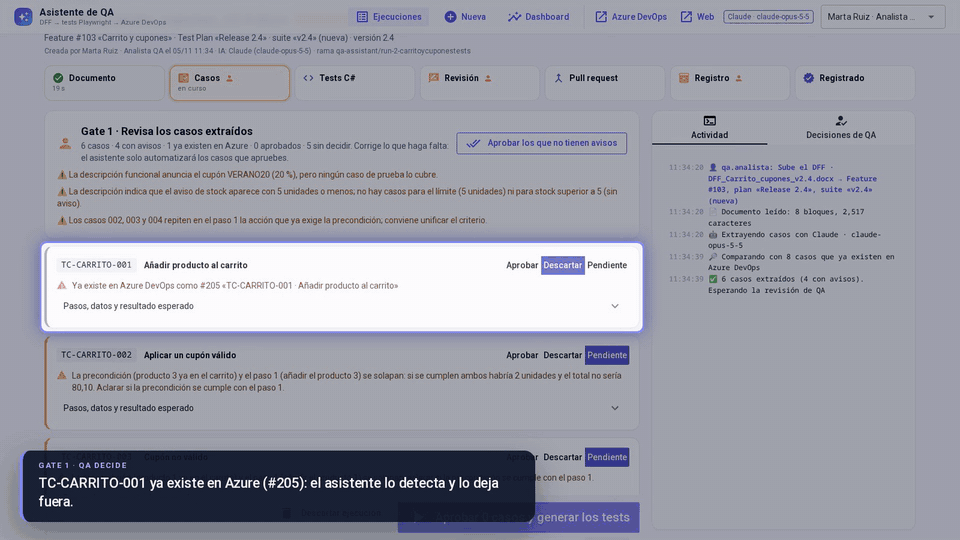
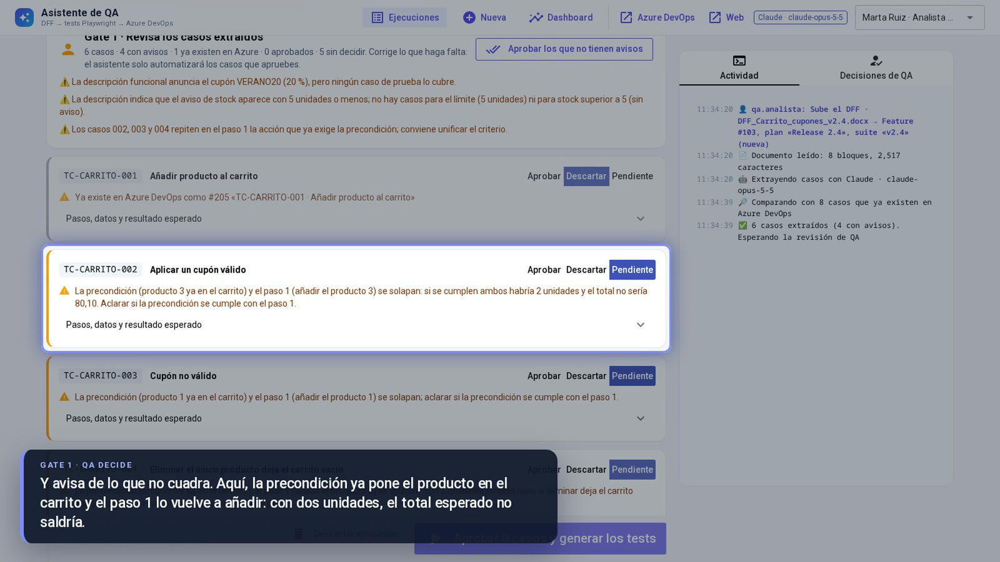
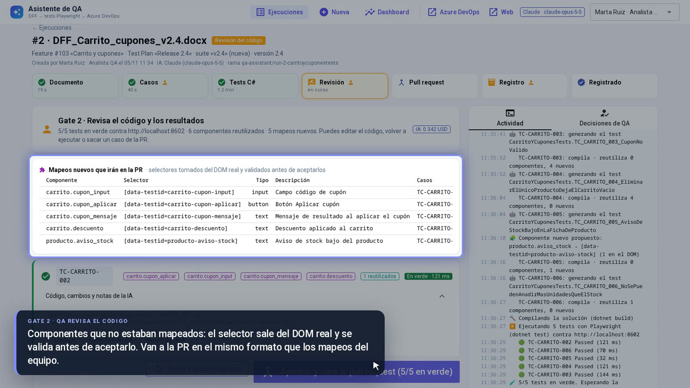
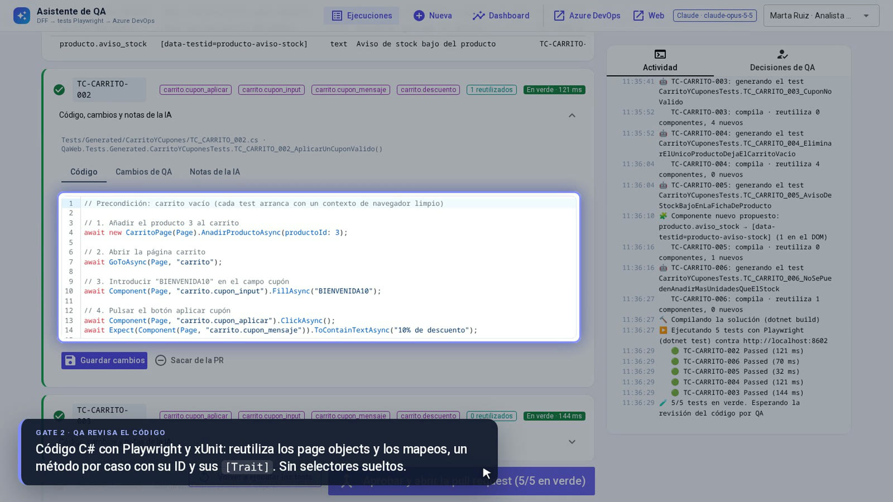
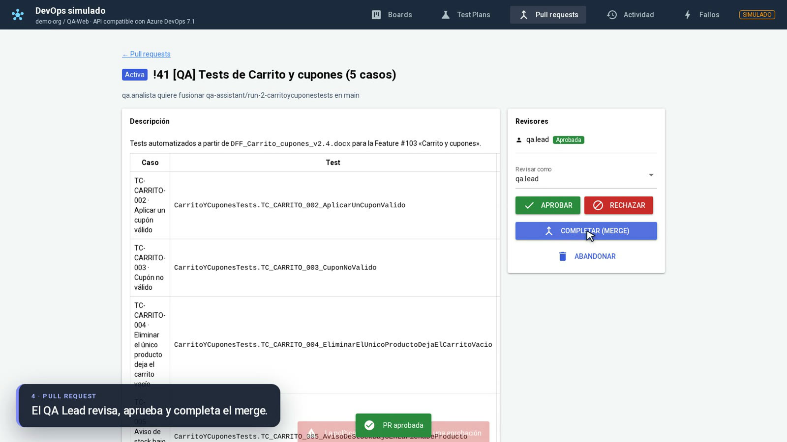
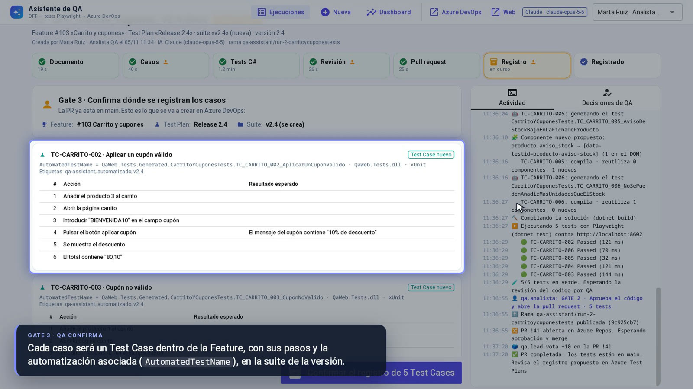
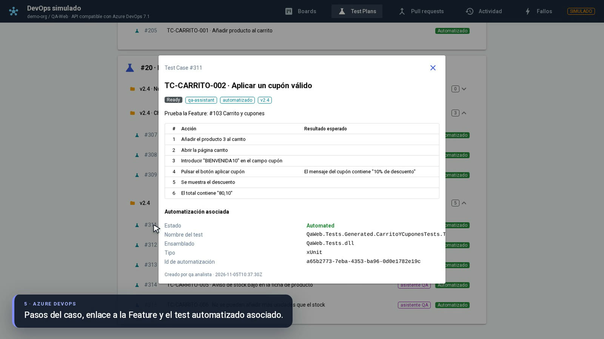
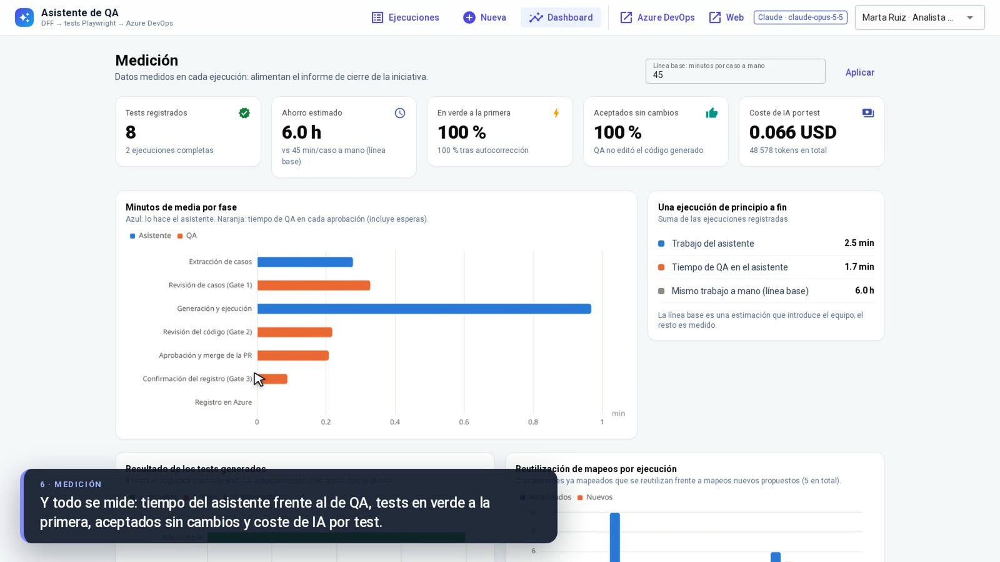
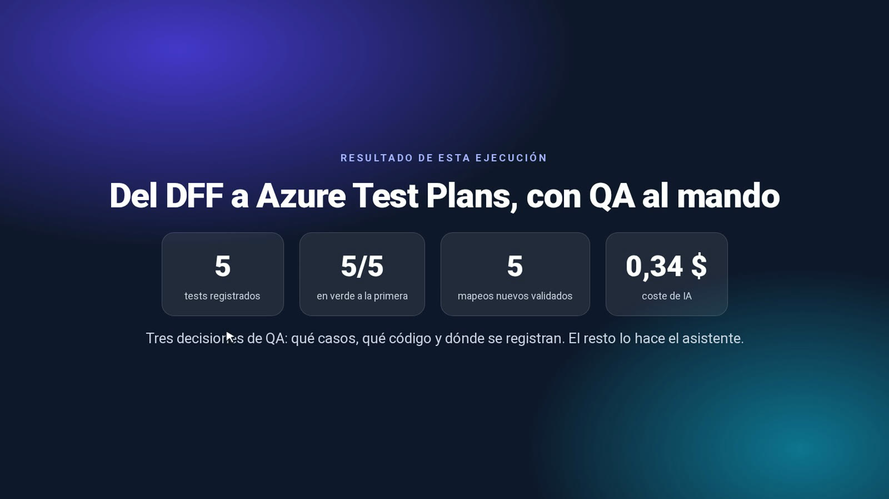

# Asistente de QA: del documento funcional al test registrado

Prueba de concepto de un asistente que recibe un documento funcional con casos de prueba (DFF) y devuelve **tests end-to-end en C# con Playwright para .NET y xUnit**. Los tests salen ejecutados contra la web, revisados en una **pull request** y registrados en **Azure Test Plans**. Una persona de QA aprueba cada paso: nada llega al repositorio ni a Azure DevOps sin su visto bueno.



▶️ **[Vídeo completo de la demo (3:26, 1080p)](https://github.com/alejbormeg/qa-test-authoring-poc/releases/download/v0.1.0/demo-asistente-qa.mp4)**, grabado sobre la app real con Claude generando en directo.

> La IA es real ([Claude](https://www.anthropic.com/claude), `claude-opus-5-5`) o simulada. Azure DevOps y la web bajo prueba se simulan en local: el simulador de Azure implementa el subconjunto de la REST 7.1 que usa el flujo, así que el cliente es el mismo que se usaría contra `dev.azure.com`.

## Qué hace

```
DFF (.docx) ──► casos extraídos ──[Gate 1: QA revisa, corrige y aprueba]──► tests C# generados, compilados y ejecutados
            ──[Gate 2: QA revisa código y resultados]──► pull request en Azure Repos (revisión y merge del equipo)
            ──[Gate 3: QA confirma dónde se registran]──► Test Cases en la Feature + suite del Test Plan
```

1. **Extrae los casos** del documento, ya sea en tabla o en prosa. Detecta los que ya existen en Azure y avisa de lo que no cuadra: resultados esperados ausentes, pasos vagos, datos contradictorios, precondiciones que chocan con los pasos.
2. **Genera los tests con las convenciones del equipo.** Reutiliza los page objects y los mapeos de componentes. Si falta un componente, lo busca en el DOM de la web real y lo propone para el mapeo; nunca se inventa un selector.
3. **Los ejecuta** con `dotnet test` contra la web y lee el resultado del TRX. Con IA real, los tests que fallan vuelven al modelo con el error real para que los corrija.
4. **Abre la pull request** con un fichero `.cs` por caso y las líneas nuevas de los mapeos. La revisión y el merge siguen el proceso normal del equipo, con política de rama incluida.
5. **Registra cada caso** como Test Case dentro de su Feature, con sus pasos y la automatización asociada (`AutomatedTestName`, `AutomatedTestStorage`, `AutomationStatus = Automated`). Después lo añade a la suite del Test Plan, por versión o por funcionalidad.
6. **Lo mide**: tiempo de cada fase (asistente frente a QA), tests en verde a la primera, código aceptado sin cambios, reutilización de mapeos y coste de IA por test.

## Garantías fuera del modelo

El modelo trabaja con herramientas acotadas (`leer_fichero`, `inspeccionar_pagina`, `proponer_componente`, `escribir_test`), y las reglas viven en el código, no en el prompt:

- Un selector nuevo solo se acepta si existe en el DOM real de la página.
- Un test se rechaza si usa selectores sueltos o componentes sin mapear, o si no compila.
- La lectura y la escritura quedan limitadas al repositorio de tests.
- Los tres gates los aplica el servicio, no solo la interfaz: sin aprobación no hay PR ni registro.
- El registro es idempotente. Tras un 503 o un PAT caducado, el reintento continúa sin duplicar Test Cases.
- Cada decisión de QA queda auditada con quién y cuándo.

Cuando al caso le falta información, el asistente no la rellena con suposiciones. Deja el test marcado como pendiente y explica el motivo, por ejemplo: «falta el resultado esperado en el caso, y hay que aclarar qué contraseña usar».

## Resultados con Claude

Medidos sobre los tres DFF de ejemplo (`sample_data/dff`). El tiempo de IA suma la extracción y la generación con la ejecución de los tests:

| DFF | Casos | Tests en verde a la primera | Componentes nuevos | Tiempo de IA | Coste |
|---|---|---|---|---|---|
| Carrito y cupones (tabla) | 6, uno ya existía en Azure | 5/5 | 5, validados en el DOM | ~1:30 | 0,34-0,40 $ |
| Checkout (prosa) | 3 | 3/3 | 0, reutiliza 7 | ~1:00 | 0,18-0,21 $ |
| Área de cliente (borrador con fallos) | 3, todos con avisos | 1/3; los otros 2 quedan pendientes con el motivo | 0 | ~3:00 | 0,58 $ |

Entre 7 y 8 céntimos por test registrado, gracias a la caché del contexto del repositorio.

## Capturas

| | |
|---|---|
|  **Gate 1**: casos extraídos, duplicados y avisos |  **Mapeos nuevos** tomados del DOM real |
|  **Gate 2**: código C# con page objects y mapeos |  **Pull request** con revisión y merge |
|  **Gate 3**: vista previa del registro |  **Test Case** en Azure con su automatización |
|  **Medición** de cada ejecución |  **Resultado** de la ejecución del vídeo |

## Arranque

Requisitos:

- Python 3.12 y [uv](https://docs.astral.sh/uv/).
- SDK de .NET 8. Sin permisos de administrador basta con instalarlo para el usuario en `~/.dotnet`, que se detecta solo:
  `curl -sSL https://dot.net/v1/dotnet-install.sh | bash -s -- --channel 8.0`
- Git.

```bash
make setup     # dependencias, Chromium de Playwright y paquetes NuGet
make seed      # estado inicial: repo de tests, Features, casos existentes y Test Plans
make up        # asistente :8600 · Azure DevOps simulado :8601/console · web bajo prueba :8602
```

Abre http://localhost:8600, pulsa **Nueva ejecución**, elige un DFF de ejemplo y sigue el flujo. La PR se revisa y se completa en la consola de Azure DevOps simulada (http://localhost:8601/console), como en el día a día; el asistente detecta el merge y pasa al registro.

**Con IA real**: copia `.env.example` a `.env`, pon tu `ANTHROPIC_API_KEY` y reinicia. Sin clave, el asistente usa una IA simulada que traduce un vocabulario controlado de pasos a C# con las mismas herramientas y reglas.

## Cómo está hecho

| Pieza | Tecnología |
|---|---|
| Asistente | Python, FastAPI + NiceGUI, SQLModel + SQLite (estado, decisiones y actividad) |
| IA | SDK de Anthropic: `messages.parse` con esquema Pydantic para extraer; `tool_runner` con herramientas propias para generar; prompt caching del contexto del repositorio |
| Tests generados | C#, .NET 8, `Microsoft.Playwright.Xunit` |
| Inspección del DOM | Playwright para Python, con el mismo Chromium que los tests |
| Azure DevOps | Cliente REST 7.1 (JSON Patch, WIQL, Test Plans, Git) con reintentos; simulador compatible con consola web |

Arquitectura, máquina de estados y decisiones de diseño en [docs/arquitectura.md](docs/arquitectura.md).

### Qué se simula y qué cambia en un entorno real

| Pieza | En la PoC | En un entorno real |
|---|---|---|
| Web bajo prueba | `mocks/demo_site`: tienda con `data-testid` | La web del equipo |
| Repositorio de tests | Solución .NET con mapeos JSON por página, page objects y tests de ejemplo (`sample_data/test-repo-seed`), publicada en un repo git local | El repositorio del equipo; el formato de los mapeos está aislado en un adaptador |
| Azure DevOps | `mocks/azure_devops`: Boards, Test Plans y pull requests con votos, política de rama y merge real, más inyección de fallos | `AZURE_BASE_URL=https://dev.azure.com` y un PAT con permisos de Work Items, Test Management y Code |
| IA | `QA_AI=claude` o `QA_AI=mock` | El modelo va detrás de un puerto (`extract` / `generate`) |

## Comandos útiles

```bash
make test          # tests unitarios y de contrato (levantan su propio Azure simulado)
make demo-e2e      # recorre el flujo entero sin UI y comprueba el resultado en Azure (con `make up` en marcha)
make video         # graba el vídeo de la demo recorriendo la app (docs/video, fuera de git)
make screenshots   # capturas de las pantallas principales (docs/capturas, fuera de git)
make dff           # regenera los DFF de ejemplo
```

## Estructura

```
src/qa_assistant/   asistente: configuración, dominio, adaptadores (Azure, git, dotnet, DOM, DFF), IA, flujo y UI
mocks/              web bajo prueba y Azure DevOps simulado
sample_data/        DFF de ejemplo y solución de tests semilla
scripts/            estado inicial, recorrido e2e, capturas y grabación del vídeo
docs/               arquitectura, guion de la demo y requisitos
```

## Documentación

- [Arquitectura](docs/arquitectura.md): piezas, flujo y estados, decisiones de diseño y uso de la IA.
- [Guion de la demo](docs/guion-demo.md): recorrido de unos 20 minutos, preparación, plan B y preguntas habituales.
- [Requisitos](docs/requisitos.md): qué tiene que cumplir el asistente y dónde está resuelto.

## Límites de la prueba de concepto

- Azure DevOps y la web bajo prueba son simulados. El cliente de Azure sigue la REST 7.1, pero no se ha probado contra una organización real.
- No hay autenticación: el usuario (analista o QA Lead) se elige en la cabecera.
- Solo web. Appium para móvil reutilizaría el flujo, las herramientas y el registro; cambiarían el ejecutor y el inspector.
- El formato de los mapeos de componentes es el de la solución de ejemplo.

## Licencia

[MIT](LICENSE)
