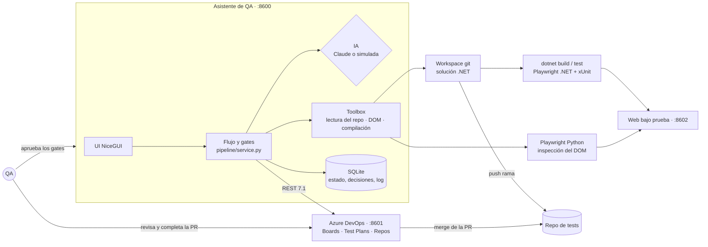
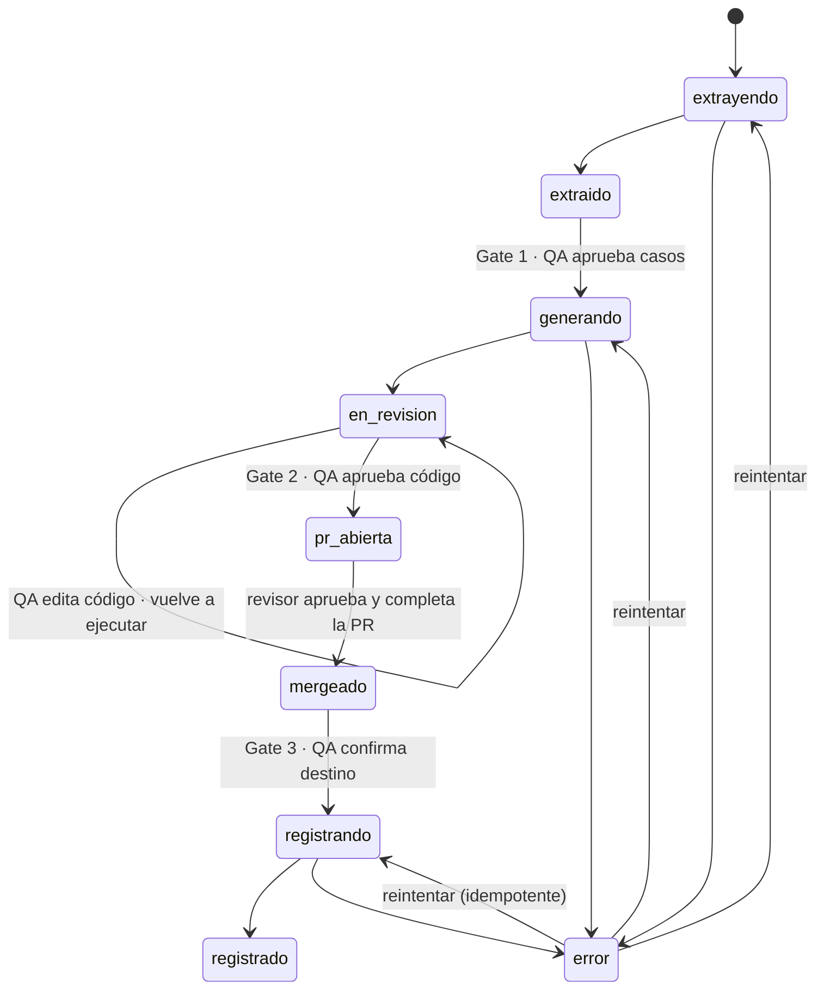

# Arquitectura

## Piezas

## Flujo y estados

## Decisiones

- **La base de datos es la fuente de verdad del código generado.** El workspace se reconstruye desde `origin/main` y los ficheros de la ejecución cada vez que hay que compilar, ejecutar o publicar. Así varias ejecuciones comparten un único clon sin pisarse.
- **Un fichero por caso** (`Tests/Generated/<Funcionalidad>/<ID>.cs`) dentro de una clase parcial por Feature. Los diffs y las revisiones van caso a caso, y el `AutomatedTestName` es estable.
- **Garantías fuera del modelo**: el toolbox valida cada selector nuevo contra el DOM real, rechaza los selectores directos en los tests, limita la lectura y escritura al repositorio y compila antes de aceptar el código. Con Claude o con el mock rigen las mismas reglas.
- **Mapeos con el mismo formato que el equipo** (una entrada por línea). Así la PR solo enseña las líneas nuevas.
- **Idempotencia en el registro**: cada caso guarda su `azure_id` en cuanto se crea. Un reintento tras un 503 no duplica Test Cases, y la suite solo recibe los que faltan.
- **Cliente de Azure compatible con el servicio real**: mismas rutas, `api-version=7.1`, JSON Patch y autenticación básica con PAT. Reintenta 5xx y 429 con espera exponencial; un 401 no se reintenta.

## IA

| Paso | Claude | Simulada |
|---|---|---|
| Extracción | `messages.parse` con un esquema Pydantic (`Extraccion`), effort `medium`, system prompt en caché | Parser de tablas y de prosa con avisos por reglas |
| Generación | `tool_runner` con `leer_fichero`, `inspeccionar_pagina`, `proponer_componente` y `escribir_test`; contexto del repo en caché, effort `high`, `fallbacks: "default"` | Traducción de un vocabulario controlado de pasos a C# con las mismas herramientas |
| Autocorrección | Los tests que fallan vuelven al modelo con el error real | No aplica |
| Coste | Tokens de `usage` × precios de `claude-opus-5-5` | 0 |
